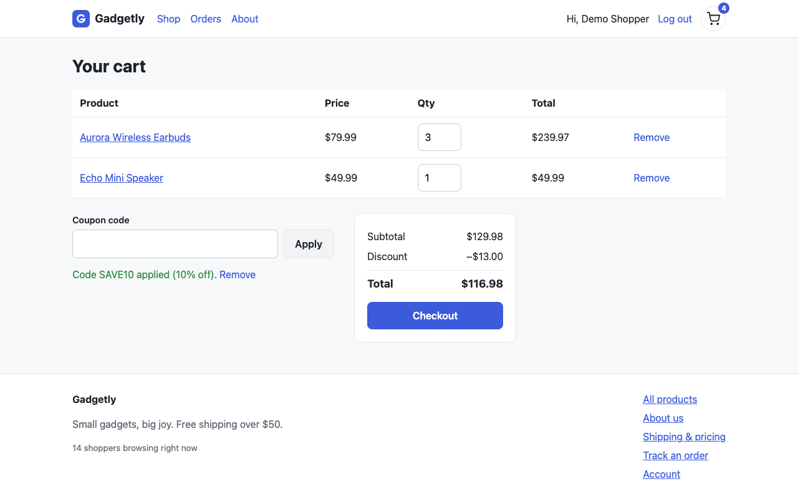

# wreck-it benchmark and evidence review

Evaluation date: October 20, 2026. The first discovery run began on October 19 local time. Timestamps in the artifacts use UTC.

This evaluation checks bug detection, generated regression tests, screenshot evidence, and adherence to the testing procedure. A detection threshold pass alone does not validate every generated test or establish that the full procedure was followed.

## Fixture and method

- Fixture: the existing Gadgetly Next.js shop with 23 seeded bugs and the unchanged `wreck-manifest.json` answer key.
- Discovery sessions received neutral app copies without the manifest, benchmark README, earlier results, or access to the other agent’s findings.
- Both agents received the same initial skill snapshot, including screenshot-evidence instructions and a correction to the main skill’s malformed YAML description.
- CLI source: commit `3000da6dd652106f7fb33c6c37ba2e6ab289ed8c`, packaged locally as version 0.1.0. This tested the local build, not a newly published npm release.
- Runtime: Node 26.10.0, npm 11.19.1, Next.js 16.3.8, React 19.3.0, Playwright 1.63.0, Lighthouse 13.5.0, axe-core package 4.13.0, and Playwright MCP 0.0.83.
- The production build and dependencies were prepared before discovery. Separate server processes supplied separate in-memory data stores and preconfigured test accounts. This measures the testing workflow after setup, not install-to-first-report time.
- Main performance phases ran separately between agents. The agents’ own internal scheduling and the second run’s network interruption limit comparisons of performance measurements.
- Raw findings and generated tests were frozen before scoring. Source hashes were checked to confirm that discovery did not fix the app. The original seeded app in the repository remains unchanged.
- Scoring used `scripts/eval.mjs` with the original manifest. The documented detection threshold is at least 80% recall and at most two false positives according to that scorer.

Exact skill and package hashes are saved with the [Sonnet metadata](2026-10-20/sonnet/metadata.json). Raw transcripts and scratch locations remain under `.wreck-it/benchmarks/2026-10-19/`.

## Detection comparison

| Agent | Automatic seeded matches | Reviewed seeded matches | Reviewed recall | Scorer-unmatched findings | Timing |
|---|---:|---:|---:|---:|---|
| Claude Code Sonnet | 19/23 | 19/23 | 82.6% | 0 | 14.6 minutes |
| Codex CLI | 22/23 | 21/23 | 91.3% | 0 | Interrupted; not a clean timing comparison |

Both reviewed recalls exceed 80%, and both automatic unmatched counts are below the documented ceiling. This clears the existing detection threshold with a qualified second-agent result. The scorer errors and incomplete ground truth for additional findings prevent interpreting the unmatched count as a general false-positive rate. Test and procedure quality remain separate issues.

## Sonnet detection result

Claude Code 2.1.304 with `claude-sonnet-5-5` found **19/23 seeded bugs, or 82.6% recall**. The existing scorer reported zero unmatched findings and a detection threshold pass. Wall-clock duration was 876.88 seconds, approximately 14.6 minutes; the CLI reported $1.01 in model usage cost.

The run produced 23 reproduced findings: 19 seeded matches, two scorer duplicates, and two manifest-recognized unseeded issues. Its severity counts were 2 critical, 8 high, 8 medium, and 5 low. The demo app’s readiness score was 0/100; this is an app score, not the skill’s benchmark accuracy.

Missed seeded bugs:

| Bug | Missed behavior |
|---|---|
| B10 | Orders page spins indefinitely for an account with no orders. |
| B11 | Sign-up error handling gives a generic message and clears the form. |
| B12 | Empty cart has no useful next step or link back to shopping. |
| B21 | Checkout phone input has no label. |

Evidence: [scorer output](2026-10-20/sonnet/eval.json), [readable report](2026-10-20/sonnet/report.md), [self-contained HTML report](2026-10-20/sonnet/report.html), and [unchanged-source check](2026-10-20/sonnet/source-integrity.json).

## Codex detection result

Codex CLI 0.163.0 produced 25 confirmed findings and 11 excluded records. Ten exclusions were consolidated duplicates; one was an inconclusive stats-soak result. The app’s source hashes were unchanged. The CLI default model was used; its exact model ID was not exposed in the JSON transcript.

The automatic result was 22/23, but root-cause review corrected two assignments. The empty-table-header accessibility finding WR-033 is not the missing empty-cart guidance bug B12, so B12 is a miss. The offline-checkout finding WR-035 is not the duplicate-order bug B15; the actual duplicate-order finding is WR-024. Correcting those assignments gives **21/23 (91.3%)**. Both B12 and the memory-leak bug B19 were missed.

The four other confirmed findings—layout shift, an empty table header, offline checkout feedback, and cart API-failure handling—are additional findings outside the seeded set. They do not contribute to seeded recall. Their existence does not establish a complete ground-truth inventory for precision measurement.

Network reconnections and a host scheduling interruption affected the run. The recorded monotonic duration was 2,244.48 seconds, while the start/end timestamps span much longer. The requested 180-second stats soak had anomalous timing, so its reported crash was correctly left unconfirmed. Do not compare this run’s duration or soak measurements with an uninterrupted benchmark.

**Screenshots:** 23/25 confirmed findings had existing image attachments; the two without images were backend latency findings. The final response embedded relevant screenshots for its two presented browser defects and linked the full report. This was substantially better compliance than the Sonnet discovery run. Selected images were visually inspected; file presence alone does not prove every image is sufficient evidence.

Evidence: [automatic score](2026-10-20/codex/eval.json), [reviewed matches and corrections](2026-10-20/codex/reviewed-eval.json), [readable report](2026-10-20/codex/report.md), [HTML report](2026-10-20/codex/report.html), [coverage notes](2026-10-20/codex/chaos-log.md), and [metadata](2026-10-20/codex/metadata.json).

## Generated regression tests

The assessor executed the final, unchanged Sonnet-generated suite with one worker, no retries, and a 30-second test timeout. Each Playwright test starts with a fresh browser context. The saved account session was reused against the discovery server.

| Outcome | Still-buggy app | Separate copy with targeted fixes |
|---|---:|---:|
| Passed | 0 | 12 |
| Failed | 15 | 3 |
| Skipped as `fixme` | 4 | 4 |
| Total generated specs | 19 | 19 |

Four performance findings were excluded by the generator. The four skipped cases covered mobile overflow, the cart button’s accessible name, price contrast, and duplicate orders. No false pass appeared in the assessor’s final still-buggy run. That does not make every failing test useful.

The 12 failures that turned green are observations on this fixture, not 12 universally validated tests. Some assertions still depend on fixture values, preceding cart state, or time-specific text. For example, WR-015 only rejects `T0` in a timestamp; a raw timestamp beginning `T11` would pass without a formatting fix. Its green result across the interruption is therefore not independent proof of a reliable date-format regression.

Three tests remained red after their reported symptoms were addressed:

| Test | Problem in the generated regression |
|---|---|
| WR-001 | Requests the hard-coded obsolete `/pricng` URL. Correcting the footer to `/pricing` leaves the obsolete URL at 404, so the test still fails although the link works. |
| WR-002 | Requests the hard-coded missing image URL. Pointing the rendered image at an existing asset fixes image loading but leaves the old URL at 404. |
| WR-011 | Looks for the charge amount inside the `Total charged` label span; the amount is a separate element. It also relies on existing cart state. |

The counterfactual fixture used an existing logo as a replacement image solely to test the generated assertion’s dependence on the obsolete URL. It is not a proposed design change to the demo. Fresh browser/API checks separately verified the corrected footer navigation, a loaded About image, and a $44.99 checkout total matching a $44.99 order charge.

Evidence: [buggy-app test summary](2026-10-20/sonnet/baseline-tests-summary.json), [targeted-fix test summary](2026-10-20/sonnet/fixed-tests-summary.json), [counterfactual source patch](2026-10-20/sonnet/counterfactual.patch), and [independent checks of the corrected behavior](2026-10-20/sonnet/counterfactual-ui-check.json). The patch was applied only to a scratch copy. No generated test was edited for these assessor runs.

### Codex test generation method

The Codex agent produced 22 final specs with a shared fixture that creates an isolated account per test. It edited all 22 CLI-generated specs and supplied custom executable assertions for seven cases that the CLI alone would mark `fixme`. Its final suite is agent-produced output after CLI generation, not evidence that the CLI alone supports those assertions. Re-running `gen-tests` would overwrite the custom changes unless the agent’s postprocessing is repeated.

The [generator comparison](2026-10-20/codex/generator-comparison.json) records the unchanged final output against a separately regenerated CLI-only copy. The assessor executes the final agent-produced suite; the targeted-fix comparison leaves unrelated defects in place, so failures for defects outside that patch remain expected.

| Codex final suite outcome | Still-buggy app | Same targeted-fix copy |
|---|---:|---:|
| Passed | 0 | 13 |
| Failed assertions | 21 | 8 |
| Timed out | 1 | 1 |
| Skipped | 0 | 0 |
| Total | 22 | 22 |

Twelve green cases correspond to behavior addressed by the patch. The thirteenth, WR-005, is a **false green**: the sign-up UI was not changed, and an independent check still received HTTP 400, displayed “Something went wrong,” and cleared the fields. Its generated test checks the retained input without first establishing that validation has completed. The result demonstrates why one no-false-pass baseline run is insufficient evidence of reliable assertions.

The targeted-fix WR-033 run timed out before its table-header assertion. It hard-codes `http://localhost:4318/cart`, ignoring the alternate `WRECK_IT_BASE_URL`; its account and cart setup occurred on the fixed server but navigation went to the original server. Two other specs also contain absolute navigation URLs. The eight remaining assertion failures concern defects not addressed by the targeted patch, rather than eight demonstrated test defects.

The first duplicate-order execution also encountered diagnostic-file errors because the two assessor runs shared an output directory. That case was rerun with an isolated output directory; it again failed the intended assertion, observing two orders where one was expected, without the diagnostic errors. The original full-suite result and the isolated rerun are both retained.

Evidence: [buggy-app results](2026-10-20/codex/baseline-tests-summary.json), [targeted-fix results](2026-10-20/codex/fixed-tests-summary.json), [isolated duplicate-order rerun](2026-10-20/codex/duplicate-order-rerun-summary.json), [independent false-green check](2026-10-20/codex/signup-false-green-check.json), and [its screenshot](2026-10-20/codex/assessor-signup-error.png).

The shared recording guide now explicitly requires an observable completion state before checking retained input in asynchronous flows. This guidance was added after evaluating these generated specs; the reported benchmark and test results have not been retroactively upgraded.

## Screenshots and reporting

The Sonnet run attached existing image files to **7/23 findings**. All seven attached references resolved. Several browser-visible CLI findings, including the broken image, dead footer link, visible `undefined`, overflow, and accessibility findings, lacked attached screenshots. Its final response named screenshot files instead of embedding them.

The saved cart image is relevant but depicts a different cart state from the finding’s prose: three earbuds and one speaker total $289.96, while the page displays a $129.98 subtotal. Captions must describe the actual image rather than repeat values from a different reproduction.

The final stored findings also differed in severity counts from the agent’s earlier generated report. The linked readable and HTML reports were regenerated from frozen final findings to correct that stale output. The raw original report is preserved in the ignored benchmark artifacts.

The skill instructions now require relevant screenshot capture and inspection, valid saved paths, inclusion of evidence for CLI-created browser findings, and actual image attachments or embeds when presenting browser bugs. They explain exceptions for defects without a meaningful visual symptom. A concrete Markdown image example was added after the discovery runs. The instructions also require report and test regeneration after the last finding update.

A fresh presentation-only check produced two image embeds with existing paths and correctly described the differing screenshot values after opening the images. Its freeform summary still miscounted findings and listed some browser issues without images. Treat that as partial compliance, not a complete presentation-quality pass; the counts and tables in this evaluation come from the frozen JSON and assessor checks.

## Coverage and scorer limits

Sonnet marked its stages complete but disclosed that it did not perform the full requested procedure. It used one browser, did not run separate persona subagents, omitted the normal-user checklist artifact, reproduced UI findings in the same session rather than fresh contexts, skipped several fault/keyboard/session checks, ran a 60-second soak instead of 180 seconds, and omitted a spike profile. Those gaps remain visible even though its detection threshold passed.

The existing scorer uses routes, keywords, and source-file matches. A shared source file can conflate different root causes: Sonnet’s separate CLS finding, WR-021, was classified as a duplicate of the undefined-rating bug B06. Codex’s empty-table-header issue was counted as empty-cart guidance, inflating its recall; offline checkout also displaced the actual duplicate-order match. Use the reviewed counts and mapping files, not the raw automatic Codex headline. Zero scorer-unmatched findings is not a general real-world false-positive-rate estimate.

The earlier October 4 result of 22/23 remains a historical result on this fixture. Different model versions, procedure compliance, and runtime conditions prevent treating these individual runs as a reliable performance trend.

## Validation of the repository and skill edits

- All six skills passed the skill-creator frontmatter validator after correcting the main description to a YAML block scalar.
- CLI test suite: 210 tests passed across 25 files. An initial attempt lacked the required browser; installing Chromium resolved those environment failures before the successful run.
- TypeScript typecheck passed.
- Evaluation-script suite: seven tests passed.
- Screenshot examples were visually inspected, and attached file references were checked.

## Work remaining before stronger marketing claims

1. Repair generated test targets and replace assertions tied to obsolete URLs with checks of the current rendered link or image. Make setup state explicit and assertions robust to unrelated data and time.
2. Cover currently skipped defects with meaningful executable checks, or label them as unsupported rather than promising a regression test for every bug.
3. Bring screenshot coverage and final-response image attachment behavior into line with the revised instructions.
4. Ensure completed-stage labels reflect actual checklist, fresh-context reproduction, fault checks, and load profiles.
5. Harden scorer matching so shared files do not imply the same root cause.

The current evidence supports a qualified statement about detecting seeded bugs on the demo. It does not support a claim that every finding has a validated regression test or that every run completes all advertised QA stages.
