# Priority-one reliability fixes and verification

October 20, 2026. Follow-up to the [blind discovery benchmark](2026-10-20-benchmark.md).

The six affected regression cases now fail at their intended assertions on the buggy fixture and pass against targeted corrections. The scorer reproduces the reviewed recall of **19/23 for Sonnet and 21/23 for Codex**, without crediting unrelated bugs that share a source file.

This is a focused verification of known defects and revised checks, not another blind agent-discovery run. The original discovery findings, generated specs, and scores remain preserved in their original folders.

## Product changes

- Findings can express a completion wait (`waitFor`), retained input (`value`), text patterns (`textMatches`), loaded images (`imageLoaded`), and working rendered links (`linkResolves`). The signup guidance waits for visible validation feedback before checking retained fields; a pending request cannot satisfy that completion step. Playwright recommends observable [web assertions](https://playwright.dev/docs/test-assertions) for application readiness.
- Sweeps check the current rendered image or link instead of pinning the old missing asset or misspelled destination. They also save a screenshot during successful fresh-context reproduction. A changed asset URL or corrected `href` can now make the same regression pass.
- Newly generated navigation and HTTP steps convert absolute URLs on the configured app origin into relative paths. `WRECK_IT_BASE_URL` can then select a different server. External destinations remain unchanged; manually customized specs still need URL review.
- `.wreck-it/generated-tests.json` records the hashes of generated specs. Regeneration replaces or removes unchanged owned specs, preserves edited or pre-existing untracked specs, and warns about them. Sidecar fixtures remain intact. `gen-tests --force` explicitly replaces custom WR specs and removes stale ones. Preserved specs must be reconciled when findings change.
- The skill now explains the label-versus-value locator mistake, complete ISO timestamp patterns, isolated setup, completion waits, regeneration warnings, and relevant screenshot presentation.

These checks originally used the local source build. On October 21, the changes were published as `@miyanishar/wreck-it@0.2.0` under the new npm account, with the same GitHub source repository. The [release verification](../releases/0.2.0-verification.json) records successful clean installs from both the tarball and npm registry.

## Verification method

The [reproducible harness](../../scripts/verify-reliability.mjs) copies the seeded Next.js shop into two temporary directories. It changes six runtime files only in the corrected copy, builds both, and starts each on a distinct local port. No runtime source in `examples/buggy-app` is fixed. The scorer's manifest is intentionally updated separately.

The actual sweep records the broken image and link. The other four findings encode the corrected checks for the failures identified in the original evaluation. The generator produces all six specs. A shared fixture creates a separate fake local account and cart for each authenticated test. Signup uses an invalid password and an 800 ms request delay, then waits for the rendered rejection feedback.

The harness changes the generated import to use that account fixture, regenerates twice, and verifies that all six edited specs and the fixture survive byte for byte. It runs the same final specs against both apps, with one worker and no retries. App URLs in recorded manual steps use `http://localhost:4318`; both runs use different override origins. Request audits verify that browser traffic does not return to the recording origin. No external service is needed.

The link screenshots come from a subsequent isolated rerun after adding a wait for the navigation result before capture. That check again failed on the buggy fixture and passed on the corrected copy. Its replay results are recorded separately in the verification JSON; the table below describes the full six-case suite.

| Outcome | Buggy fixture | Corrected copy |
|---|---:|---:|
| Passed | 0 | 6 |
| Failed at the intended assertion | 6 | 0 |
| Test timeouts | 0 | 0 |
| Skipped | 0 | 0 |

Evidence: [results, errors, URL audits, and source hashes](2026-10-20/reliability-fixes/verification.json), [final specs and fixture](2026-10-20/reliability-fixes/tests/wreck-it/), [counterfactual patch](2026-10-20/reliability-fixes/counterfactual.patch), and [report with screenshot attachments](2026-10-20/reliability-fixes/report.md). These six checks do not establish that every future generated assertion is reliable.

The replacement About image is the existing logo, solely to verify that the assertion follows a changed `src`. It is not a proposed design change to the demo.

## Inspected screenshot evidence

The IDs below belong to the focused verification set; they are separate from the Sonnet and Codex discovery IDs. Each finding has an inspected failure-state screenshot in its exported evidence. Both variants' screenshots are retained.

### WR-001: Broken image

The old HTTP check pinned `/images/team-photo.jpg`. The revised check inspects the rendered image's completed load and nonzero natural width. The buggy screenshot shows the broken-image icon and alt text; the corrected copy loads the existing logo.

| Buggy | Corrected |
|---|---|
| 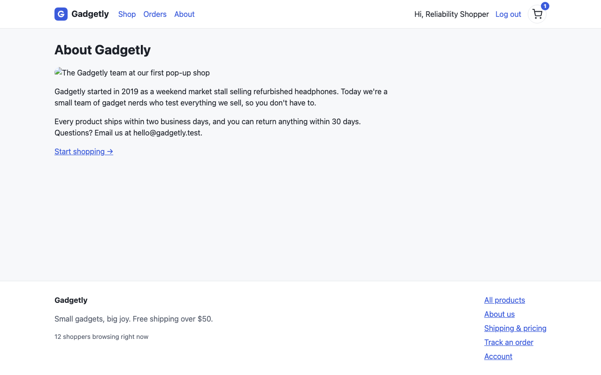 | 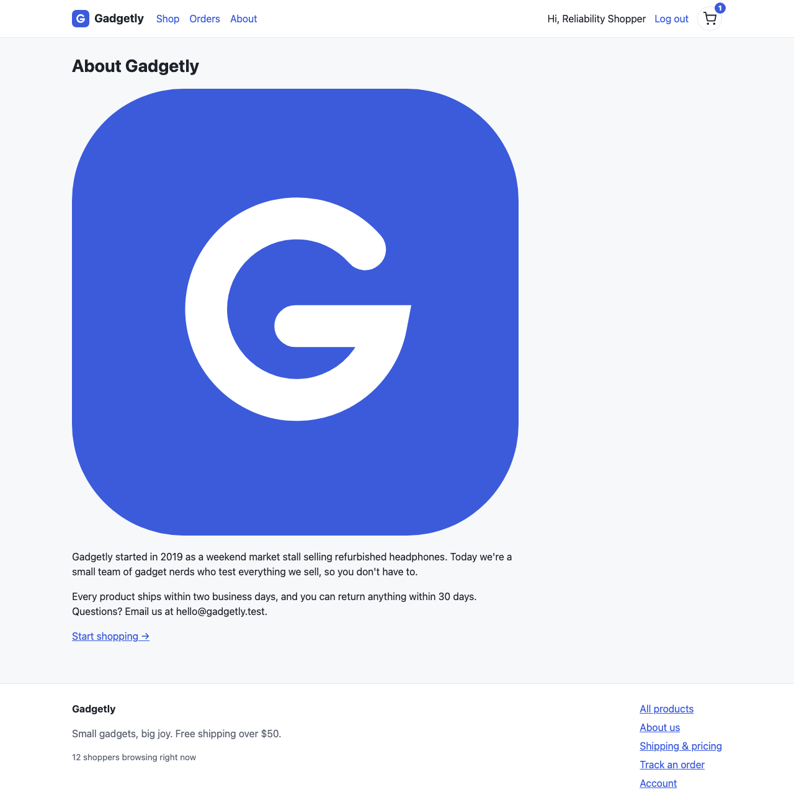 |

### WR-002: Broken footer link

The revised check reads the footer link's current destination and checks its response. The buggy destination returns 404; the corrected destination resolves to `/pricing`. The screenshots show the destination after following that link; the assertion result separately records its HTTP status.

| Buggy | Corrected |
|---|---|
| 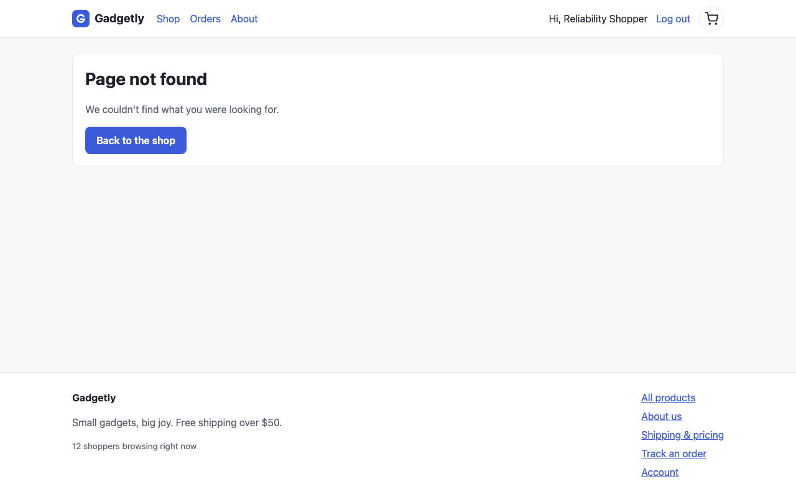 | 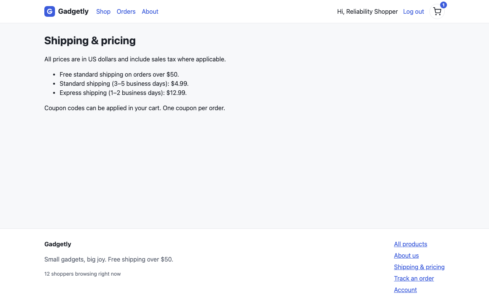 |

### WR-003: Signup validation

After completed rejection, the buggy form shows “Something went wrong” and blank fields. The corrected copy retains the entered name and email and explains the password length requirement. The test waits for `.error`, then checks both values and the validation message.

| Buggy | Corrected |
|---|---|
| 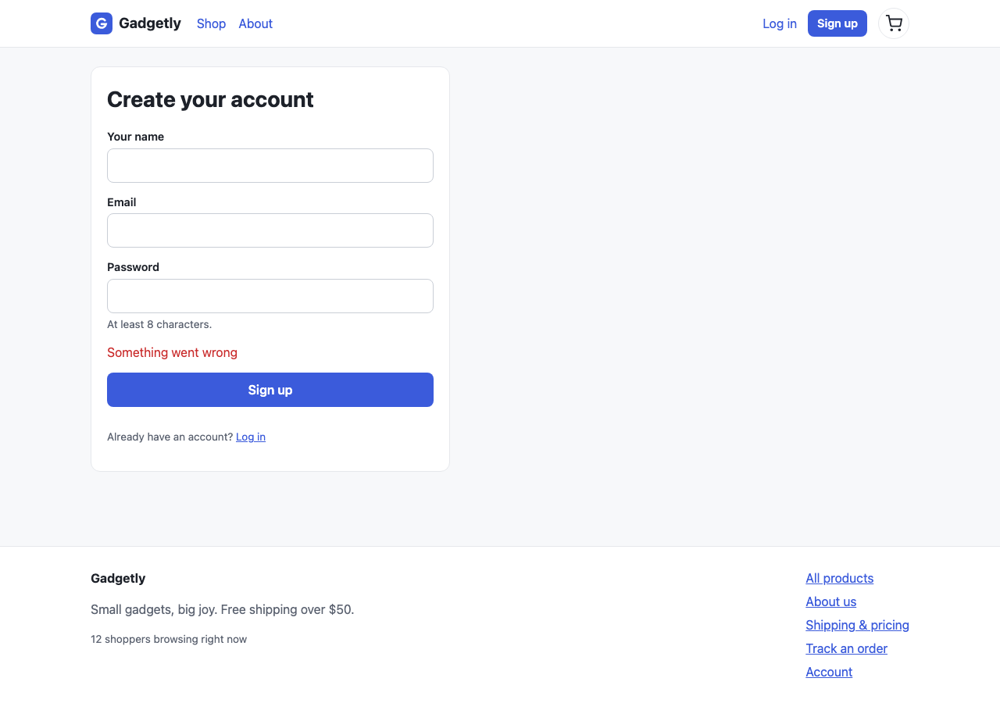 | 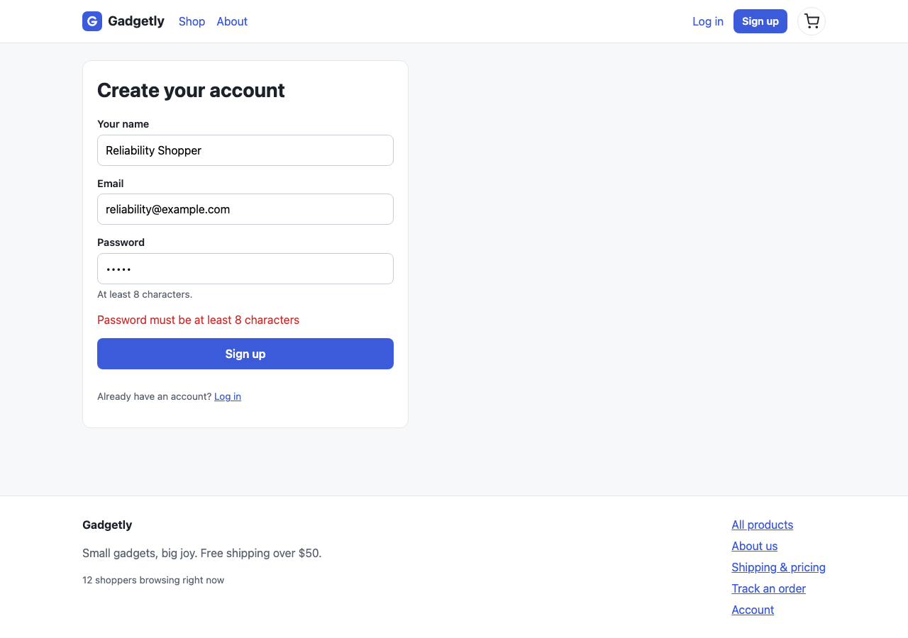 |

### WR-004: Coupon charge

A fresh cart contains one $49.99 speaker. SAVE10 should yield $44.99. The buggy order shows $40.49; the corrected copy shows $44.99. The assertion targets the whole total row, including the amount, after the order heading appears.

| Buggy | Corrected |
|---|---|
| 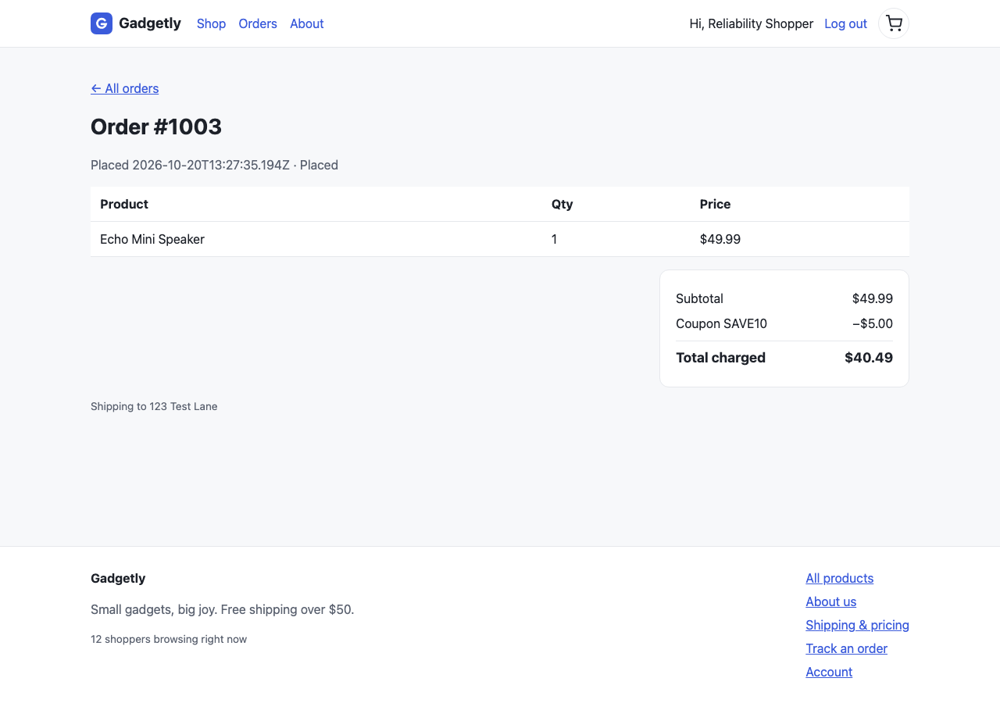 |  |

### WR-005: Date formatting

The test checks for a visible “Placed” date and rejects a full ISO date-time pattern. It detects a raw timestamp during the afternoon UTC, which the previous `T0` fragment would miss. The corrected copy displays a calendar date.

| Buggy | Corrected |
|---|---|
| 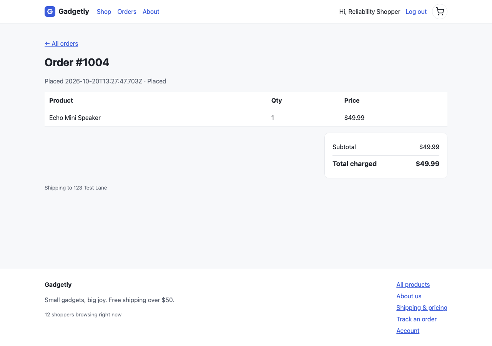 | 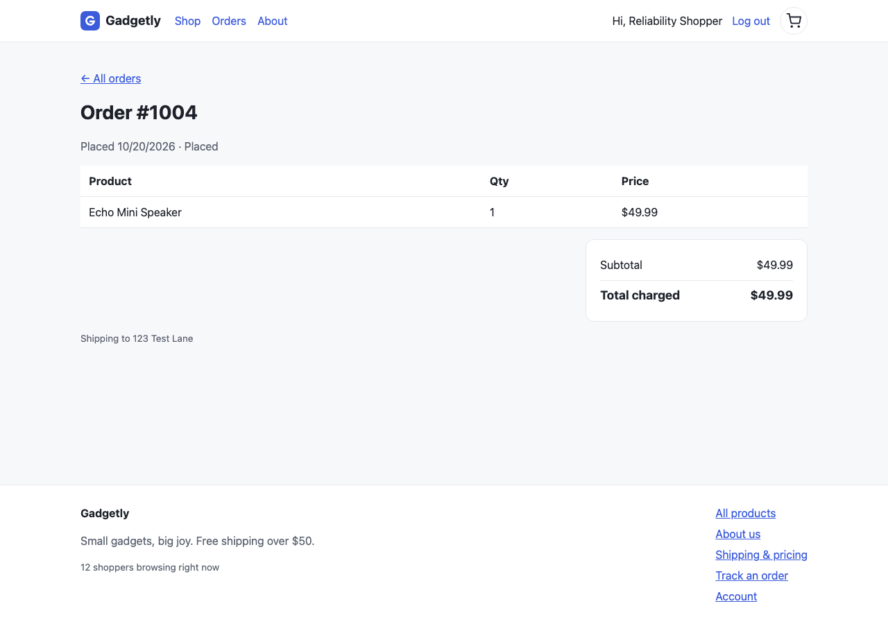 |

### WR-006: Cart table header and alternate server

The buggy actions column has an empty header; the corrected copy labels it “Actions.” The same generated spec reaches the intended header assertion on both alternate servers. This exercises the previously failing absolute-navigation case. Screenshots show the visual state; the DOM assertion supplies the header-text evidence.

| Buggy | Corrected |
|---|---|
| 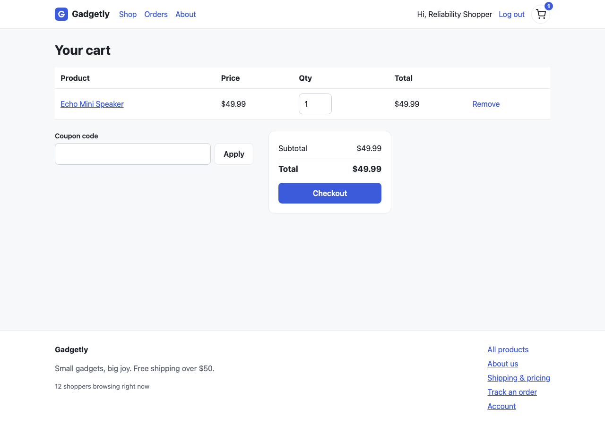 | 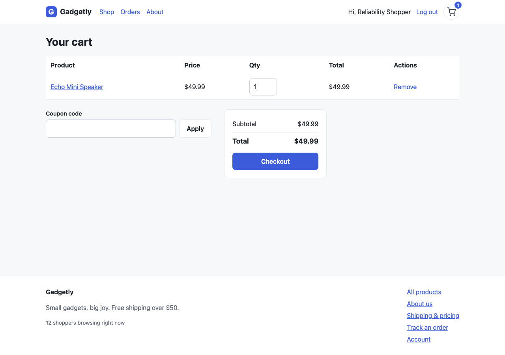 |

## Corrected scoring

Source files and nearby lines now support a match only after diagnostic prose identifies the behavior. The scorer uses the finding title and source explanation, avoiding unrelated symptoms copied into a full-page snapshot. Each manifest entry defines groups of behavioral phrases that must all match. Findings choose their strongest root cause, including known unseeded issues, before deduplication. A duplicate cannot fall through and earn credit for another bug. Equally strong matches are marked ambiguous, receive no seeded credit, and prevent a gate pass pending review.

The updated manifest adds four previously reviewed unseeded issues: layout shift, an empty table header, missing offline checkout feedback, and cart API-failure handling. They are listed separately from the same 23 seeded bugs and do not increase seeded recall. This is a clarified answer key applied to frozen findings, not additional blind discoveries or a general precision measurement.

| Frozen run | Rescored seeded matches | Missed seeded bugs | Known extra findings |
|---|---:|---|---:|
| Sonnet | 19/23 | B10, B11, B12, B21 | 3 |
| Codex | 21/23 | B12, B19 | 4 |

There are no unmatched or ambiguous findings under this updated known-issue inventory. Codex B15 maps to the actual duplicate-order finding WR-024. Its empty-header WR-033 earns no B12 credit, and offline checkout WR-035 earns no B15 credit. Sonnet's CLS finding is an unseeded layout-shift issue, not an undefined-rating duplicate.

## Project checks and remaining limits

All 216 CLI tests, 10 scorer tests, the TypeScript check, build, and skill validator pass. The focused results and screenshots are saved beside this document. The harness stops its servers when finished.

The remaining missed seeded bugs, incomplete full-run procedure coverage, and other unsupported regression assertions remain documented in the original benchmark. This follow-up addresses the identified reliability defects without claiming a new full-run result or validating the four skipped Sonnet checks. The [October 21 release verification](../releases/0.2.0-verification.json) completes the publishing and installation checks needed before the demonstration video.

To reproduce, prepare a directory containing Next.js and `@playwright/test` dependencies, then run:

```bash
npm run build
node scripts/verify-reliability.mjs --deps /absolute/path/to/node_modules --out .wreck-it/reliability-check
```

The dependencies must match the fixture's installed versions. The recorded check used the same Next.js 16.3.8 and Playwright 1.63.0 dependencies as the original evaluation. A failed check exits with an error and leaves scratch outputs for diagnosis.
